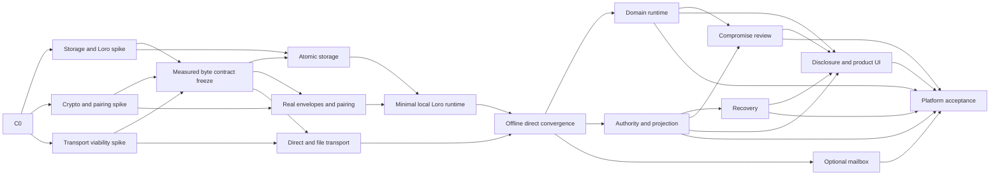

# Loro execution plan

This is the work graph for the [confirmed decisions](LORO-IMPLEMENTATION-DECISIONS.md), [implementation design](LORO-RELAY-IMPLEMENTATION.md), [policy contracts](LORO-POLICY-CONTRACTS.md), and [sync protocol](LORO-SYNC-PROTOCOL.md). Their product scope is binding. The isolated PoC is evidence for limited scenarios, not runtime, security, or crash proof. No migration, silent reset, automatic branch reconciliation, mandatory account or relay, or background-delivery guarantee is included.

## Ownership and integration rules

The **integration owner** owns contracts, the integration base, dependency selection, and integration. Only this owner edits shared `package.json`, lockfiles, `app.config.ts`, app-root wiring, and `src/loro/contracts/` contract/version files. A spike's isolated manifest may be explicitly assigned to its worker before dispatch; shared native project/SDK configuration remains single-owner. Each package below has exclusive proposed paths; create its directories if absent. Existing `server/powersync/.probes/` is preserved. Workers do not edit another package's paths; request a contract change instead. The path map here refines the earlier proposed flat module layout; update callers through the integration owner. Exact paths may be adjusted before dispatch, with ownership recorded in the brief.

Start with a short interface freeze (C0): assign paths and record versioned interfaces for atomic commit/inbox, encrypted objects, pairing, transport frames, domain commands, authority decisions and projection. Initial shapes can use opaque bytes; C0 does not preselect an unproved crypto binding. After the spikes, the owner publishes the relevant byte/schema/suite decisions and fixtures as C1 before integrating production adapters. C1 is an integration checkpoint, not another speculative research round; S2/T2 can continue against unchanged C0 interfaces while measurements settle. Provide deterministic byte fixtures and explicit errors, size limits and compatibility behavior. Fixtures are not encryption. A change request names the affected invariant, proposed interface, compatibility impact and affected packages; pause dependent work at that boundary, update contracts and fixtures together, notify owners, and rebase/revalidate affected work before integration. No silent assumption changes.

All workers branch from the integration owner's named immutable base commit. Handoffs identify base, head, contract version, changed paths, commands and results, known gaps and integration order. The owner integrates small commits in dependency order, publishes a new base and directs affected workers to rebase and rerun targeted checks. Never integrate incompatible contract versions merely because tests use matching fakes.

## Graph and gates

Text equivalent: C0 precedes three independent feasibility gates S1, K1 and T1. S1, K1 and T1 feed C1, the integration owner’s measured byte-contract freeze. S2, K2 and T2 depend on their respective spikes and C1 for production integration; S2 and T2 may prepare against C0 fixtures before C1. S2 and K2 feed the minimal runtime L1; L1 and T2 feed E1. E1 enables D, A and R; A enables H; both A and D enable Q; D, A, H and Q feed U; all later packages feed P. The critical path to E1 is `max(max(S1, K1, T1)→C1→max(max(S2, K2)→L1, T2))→E1`, plus integration work and actual worker/build scheduling. It cannot be named more narrowly until spikes measure it. The release critical path continues through the slowest required D/A/R/H/Q/U dependency chain and P. If one gate fails, its owner records the failure and next measurable alternative; independent chains and fixture-based interface tests continue, but E1 and dependent claims remain blocked. Debugging has no attempt limit.

Each package hands off its commits, targeted test output, observable evidence and unresolved limitations. Cut at each listed semicolon into small reviewable commits or PRs; dependencies are package IDs, not a promise of simultaneous staffing.

| ID and prerequisites | Owner; exclusive paths | Inputs → outputs; focused tests and done evidence; cuts |
|---|---|---|
| S1 (C0) | Storage engineer; `spikes/loro-storage/` | Pinned candidate Loro, op-sqlite and IndexedDB → measured native/web feasibility and fault cases. Prove reopen and transaction failure behavior on actual runtimes; hand off versions and reproducible results; spike harness; findings. |
| K1 (C0) | Security engineer; `spikes/loro-crypto/` | Reviewed binding candidates and transcript contract → web/Hermes interoperability, authenticated pairing and negative-test evidence. Measure signing, wrapping, AEAD, nonce and encoding compatibility; hand off candidate and failure cases; harness; decision evidence. Integration owner makes final choice. |
| T1 (C0) | Transport engineer; `spikes/loro-transport/` | Frame fixtures → browser/native data-channel and manual signaling feasibility without account or external STUN/TURN. Exercise chunking, backpressure and reconnect; record platform restrictions and file fallback; fixture harness; runtime evidence. This does not prove encryption. |
| S2 (S1, C1 for integration) | Storage engineer; `src/loro/storage/` | Atomic commit API → native op-sqlite and web IndexedDB adapters. Fault-inject domain output, effect ID, immutable outbound bytes and outbox insertion; inbound ciphertext/cursor and later import/status each commit atomically. Reopen after failure without false saved state; adapter commits; crash tests. |
| K2 (K1, C1) | Security engineer; `src/loro/crypto/`, `src/loro/pairing/` | Owner-pinned suite and canonical schemas → real signed authenticated envelopes and transcript-bound pairing. Interop and tamper, replay, wrong-domain/version and unverified signaling tests; proof both runtimes exchange actual ciphertext; encoding/envelopes; pairing. |
| T2 (T1, C1 for integration) | Transport engineer; `src/loro/transport/` | Frame contract → direct channel and encrypted file adapters, bounded staging and receipts. Fixtures can precede K2; test malformed frames, limits, resume and file round trip. Real envelope integration follows K2; direct adapter; file adapter. |
| L1 (S2, K2, C1) | Runtime engineer; `src/loro/engine/` | Durable store and real envelopes → minimal Loro command/import/commit loop for a recipe and purchase event. Own working-document rollback/reopen, durable semantic IDs and inbox/outbox orchestration; no full cooking screen integration yet. Test failed commit after in-memory mutation, duplicate import and restart; local command loop; inbound loop. This closes the gap between storage adapters and actual offline editing. |
| E1 (L1, T2, C1) | Integration owner; `tests/loro/integration/` and shared app-root wiring | Real adapters → two offline clients edit, reconnect directly without relay, exchange encrypted updates, converge and reopen after restart. Include duplicate/reordered delivery and failed commits; record actual platforms and transcript. Pass browser↔browser first, then browser↔Android; distinguish each result. Fake adapters alone cannot pass; integration wiring; end-to-end proof. |
| D (E1) | Domain engineer; `src/loro/domain/` | Domain command and atomic effect contracts → immediate offline edits, competing intentions, independent purchase events and retry deduplication, durable Chef proposal/effect idempotency. Test concurrent purchases and retry/crash; document codecs; domain commands; Chef integration. |
| A (E1) | Authority engineer; `src/loro/authority/`, `src/loro/projection/` | Frozen parent and envelope contracts → adult/device authority, admission `max(1,N-1)`, unanimity/fixed choices, policy transitions and visible siblings. Newcomer projection uses fresh documents and keys; byte-level canaries prove deleted/history/personal material and old keys absent. Test duplicate devices, competing heads and old-generation pending edits; authority; projection. |
| R (E1) | Relay engineer; `server/loro-mailbox/`, `src/loro/relay/` | Same encrypted objects and receipts → optional ciphertext mailbox with durable idempotent PUT, quotas and explicit retention. Test retries, capacity and peer versus relay receipt; server; client. No authority selection or background-delivery promise. |
| H (A) | Recovery engineer; `src/loro/recovery/` | Authority and key catalog interfaces → optional personal recovery and configurable guardian assistance in first release, with distinct holders and authenticated scoped packages. Test threshold loss, no silent lowering, absence of household keys in personal packages, missing ciphertext and separate current-adult readmission; personal recovery; guardian packages; readmission. |
| Q (A, D) | Recovery engineer; `src/loro/compromise/` | Checkpoint and real domain semantic effect codecs → bounded frozen review and selected-boundary reconstruction, preserving original history and dependent honest edits for explicit selection. Test late submissions, limits, missing dependencies and revoked late edits; intake; reconstruction. |
| U (D, A, H, Q) | Product UI engineer; `src/loro/ui/` | Stable domain, authority and recovery APIs → setup, storage pressure, status, trust branches, recovery and disclosure controls. Test exact-payload shared-cooking AI preference override, recorded disagreement, blocking rules and protected private scope; explain two-adult admission and fresh start. Setup/status; recovery/trust; disclosure. |
| P (D, A, R, H, Q, U) | Integration owner; `tests/loro/acceptance/` | Integrated candidate → native and web acceptance with real adapters, restart/fault and cross-platform encryption, direct exchange and file fallback, optional relay, projection canaries, recovery and bounded compromise cases. Verify no reset of existing data and no mandatory account. Capture commands, platform versions and observable results; platform proof; release checklist. |

## Schedule and constraints

Wave 0: C0 and dispatch briefs. Wave 1: S1 and K1 take the first two available worker slots; T1 is the next independent queued task. Wave 2: S2, K2, T2 follow their own spikes; owner publishes C1, integrates L1 and then E1. Wave 3: D and A take the two slots after E1; R starts when one becomes free. Wave 4: H follows A; Q follows both A and D. H and Q share a proposed owner, so schedule sequentially unless ownership is explicitly reassigned; U begins only against stable interfaces, with unfinished screens queued. Wave 5: P integrates all required controls. Domain codec and UI preparations can start earlier against C0 fixtures, but do not count as completed D/U before their real prerequisites pass. These waves express dependency, not calendar promises.

Inventory at drafting is root checkout, an unrelated pre-existing backend worktree, and the transient planning checkout: all three permitted slots are occupied. After the completed planning checkout is normally removed, one implementation-worker slot is available. Do not delete or repurpose the unrelated worktree. Until another slot becomes available, execute S1 then K1/T1 serially while keeping independent briefs ready. Two active coding workers are appropriate only when root plus two worker checkouts fit within the three-slot project limit; worktree capacity is counted across the project, not just this task. Review source packets need no checkout. Builds, tests and servers use `agent-heavy`; all jobs share 42G and normally cap at 16G each. Serialize native-heavy work with an explicit build/device reservation and share caches, without separate SDK or build copies. Device proof uses a separate `device_open` session per worker, never another session or the physical Sony phone. Before a step expected to write over 5 GiB, run `agent-disk-check`; carry forward the user's approval, “Continue, don't worry until we get below 50G (which we shouldn't)”, for this project's disk budget rather than reasking above that boundary.

## Decisions and review

Integration owner records measured decision gates: supported Loro/native/web versions must reopen and survive injected transaction failure (S1); crypto bindings and canonical encoding must interoperate and reject tampering across web/Hermes (K1); direct transport must exchange bounded bytes on actual native/web runtimes with manual signaling (T1); retention and intake limits must be checked against measured histories and capacity before P. A failed choice returns to its owner with evidence and another candidate; settled product choices do not reopen by default.

Documentation needs no mandatory review. For ordinary implementation request one fresh Luna reviewer; for relevant cryptography, authorization or persistence/data-loss changes use a Sol security/data-loss review loop instead. One review route per change, no duplicate consultant sign-off. Review a frozen candidate commit or immutable source packet, never a moving shared checkout. Fix findings and re-review the changed candidate. Default to at most three review rounds; further rounds require a specific unresolved security, authorization, data-loss or concurrency issue. This is a review-round policy, not a debugging attempt limit. No redundant council.

Staff implementation and coordination with Terra. Use Luna medium for narrow fresh-context scouts when needed, and Sol for security reviews and hard consultations supplied with the relevant facts. Do not launch another council.

## Common dispatch contract

Every dispatch names the package ID, exact base commit, contract revision, exclusive paths, public interfaces and errors, fixture inputs, observable done criteria, targeted checks, review route and handoff evidence. Name permitted dependency/config changes before work begins; route shared changes to the integration owner. Require workers to preserve pending/disputed work, report assumed proofs versus runtime evidence, and keep all helpers and test identities isolated. Handoff is plain Markdown, not another ledger. Workers do their own focused tests through `agent-heavy`, do not spawn more workers, do not silently pivot product scope, and do not push or merge an integration base independently. Only the coordinator maintains the short scratch `STATE.md` and schedules integration, review and cleanup. New security review rounds use fresh delegates; ordinary continuation of a coding package can reuse its worker.

## Dispatch-ready next work

1. **Storage engineer, S1** — From the named integration base after C0, own only `spikes/loro-storage/`. Prove Loro persistence and atomic failure/reopen on native op-sqlite and web IndexedDB, including proposed outbox boundary. Return candidate versions, commands, observed results, failure modes and a small committed spike. Do not edit dependency manifests; request integration-owner changes.
2. **Security engineer, K1** — From the same frozen C0 base when a permitted worker slot is available, own only `spikes/loro-crypto/`. Compare reviewed bindings on web and Hermes with canonical test vectors, authenticated transcript binding and negative cases. Return interoperable evidence and a recommendation for the integration owner's suite and encoding decision. Do not invent a cipher or edit shared manifests.

T1 is the next queued independent brief: transport engineer owns `spikes/loro-transport/`, proves native/browser manual-signaled direct byte exchange with bounded frames, and reports fallback and restrictions. This planning task starts no implementation, device run or deployment. When implementation is dispatched, existing user authority already covers local builds, tests and emulator work within the stated limits; do not invent another approval gate. Production deployment remains separate.
