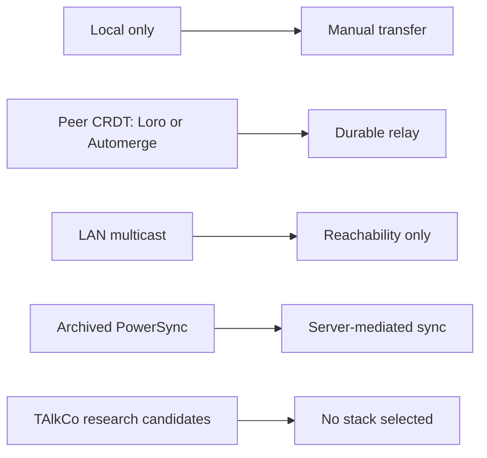
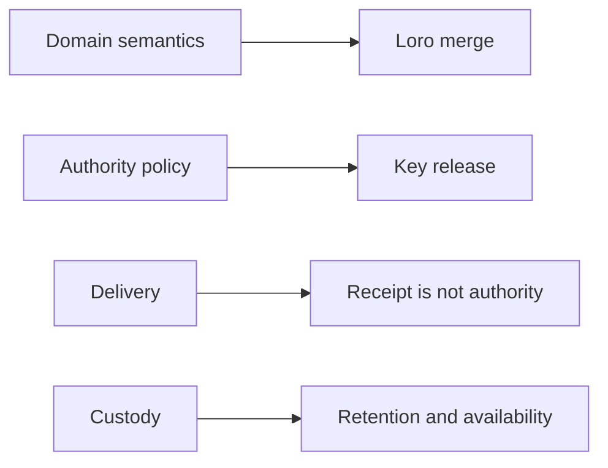
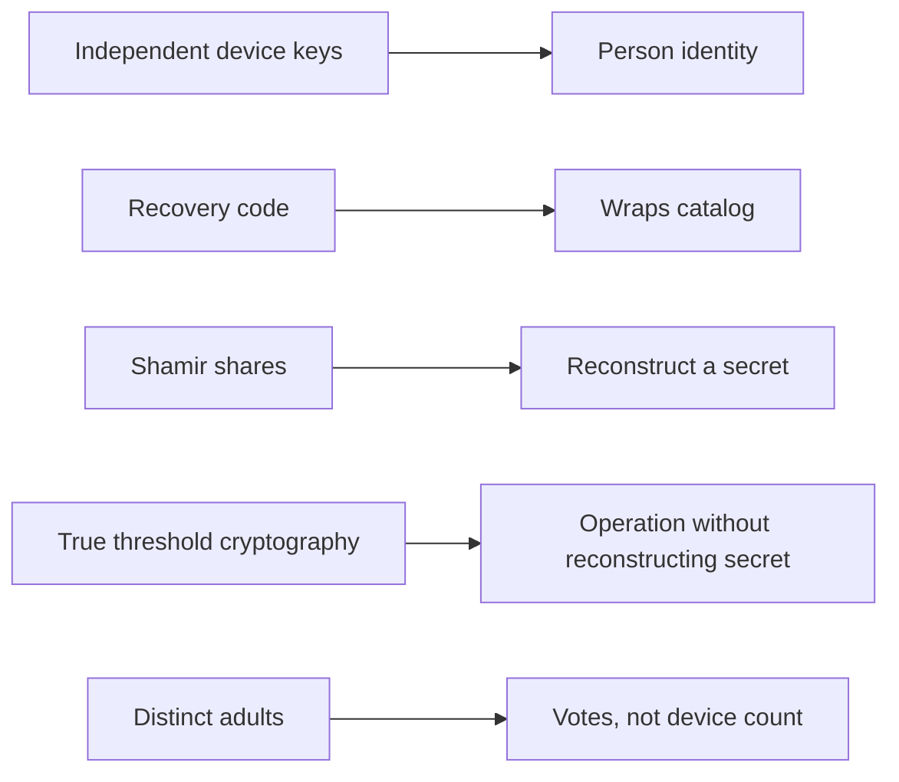
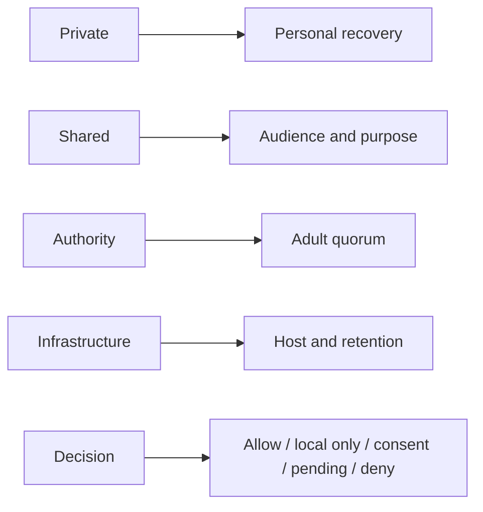
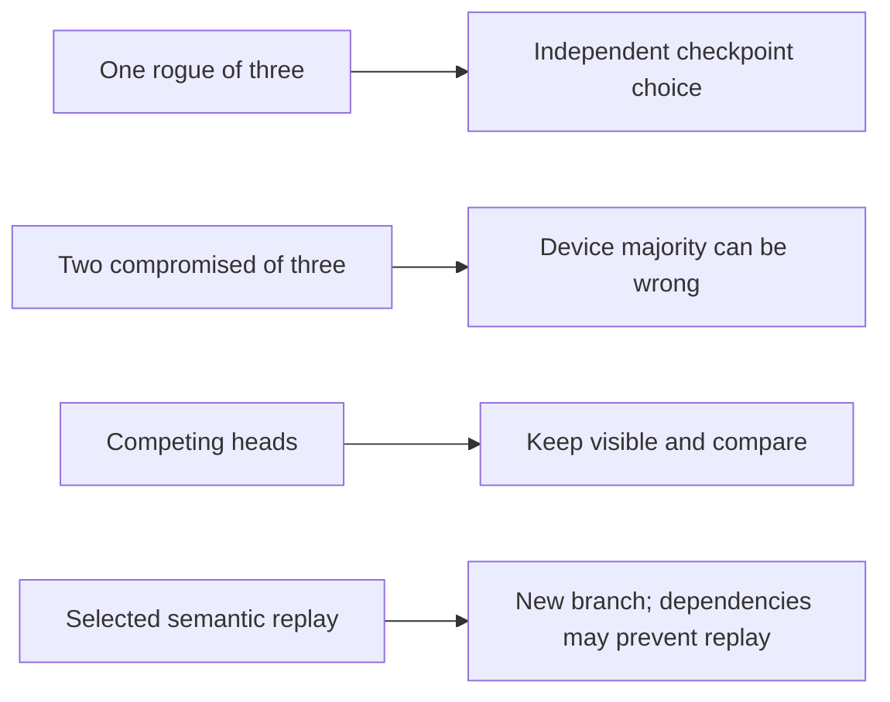
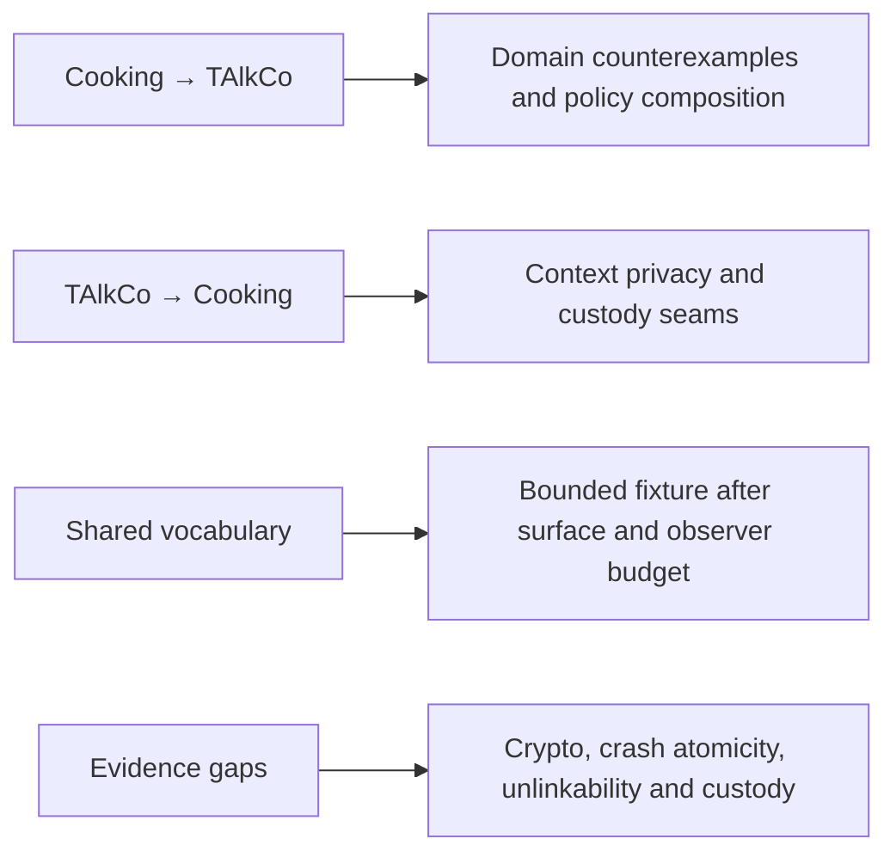

# Sync options diagrams

Evidence legend: **implemented** means source code exists; **model** means an executable illustration; **proposed** means design; **unverified** means evidence is missing. Sources: [comparison](TALKCO-COMPARISON.md), [relay plan](LORO-RELAY-IMPLEMENTATION.md), [contracts](LORO-POLICY-CONTRACTS.md), and [spike](../../spikes/relay-household-poc/README.md).

## Architecture alternatives

Alternatives, not a single pipeline. Automerge 3.5 Hermes failed a historical probe; this is not a universal incompatibility claim.

## State and trust layers

Each layer has its own owner and evidence. A relay receipt is neither peer receipt nor a custody guarantee.

## Keys and people

Recovery alone does not restore current household keys or votes. Shamir sharing alone is not threshold signing.

## Composed contracts

Applicable rules intersect; changed content, recipient or purpose requires fresh consent. Silence is not consent.

## Fork and recovery

Checkpoint choice is social input, not an honesty oracle. Preserve original history and do not promise removal of causal operations.

## Reuse and evidence

Share fixture vocabulary first, not a production engine or untested wire format.
