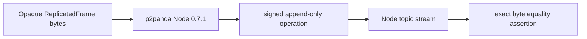
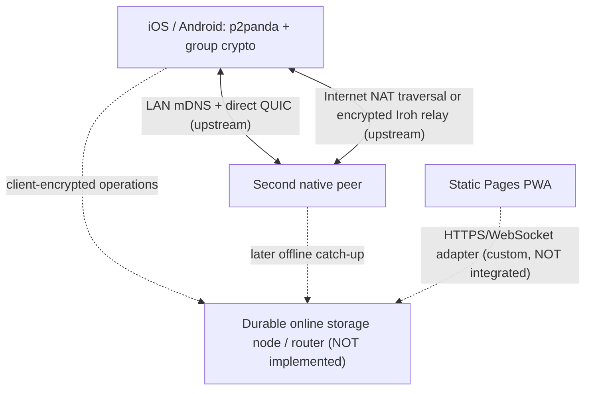

# Local-first device sync substrate: p2panda + Iroh feasibility spike

**Assessment date:** 2026-10-12. **Status:** experiment only; **not a production architecture decision**. **Branch:** `spike/local-first-p2panda`. **Base:** Creative Cooking `main` at `a1c8993c4f45e9bb8de2b18d4f644088df99845a`.

> **Security caution:** p2panda's high-level API and group encryption/authorization integrations remain experimental and pre-1.0. In particular, p2panda's encryption documentation says the crypto has not undergone a security audit. The standalone HTTP ciphertext mailbox in this repo is **not** p2panda, has **no authentication** or anti-abuse controls, and MUST NOT be publicly deployed. Nothing in this branch replaces production persistence or provider-key protection.

## Executive finding

p2panda is a credible **native-side signed event delivery, local discovery, and reconnection** candidate. It can carry an *opaque* Automerge or Loro update without parsing a recipe. Iroh substantially reduces work for native NAT traversal and encrypted live fallback. p2panda Spaces supplies useful cryptographic building blocks for personal/household membership, but connecting them securely to the latest high-level node, production-quality key lifecycle, and mobile/native bindings requires significant work.

**The hard gap is asynchronous cross-device catch-up when no participating user device stays online.** A normal Iroh relay forwards encrypted traffic between online endpoints; it is not a persistent mailbox. **The spike now demonstrates a viable native alternative: a third p2panda process C receives and persists A's signed opaque frame in SQLite, A and C are SIGKILLed, C restarts, and a freshly started B fetches the exact frame from C.** This proves a persistent full p2panda peer *can* act as an asynchronous intermediary on one Linux host without A/B uptime overlap. It does **not** establish an always-available, costed hosted service, mobile deployment, untrusted replica authorization, or ciphertext-only group encryption. The September 2026 Dash Router work describes a separate promising future store-and-forward strategy. A static GitHub Pages app alone cannot host any of these persistent services.

**The second hard gap is the static PWA.** The high-level p2panda Rust `Node` with SQLite/mDNS/UDP transport is not proven to run as an ordinary browser peer. This spike builds a *browser-compatible HTTPS-style catch-up interface* and a localhost-only encrypted durable mailbox as an alternative topology, **not** browser-to-p2panda interoperability. Do not mark browser interoperability complete.

The branch changes only `experiments/p2panda/`, this report, and the opt-in isolated experimental workflow. There is **no import into `src/`, package change, normal storage/backup migration, provider-key change, or user rollout**.

## Provenance and exact versions

| Component | Reviewed release / commit | Evidence and maturity |
| --- | --- | --- |
| p2panda core / net / sync / spaces / auth / encryption / store | **0.7.1**, upstream release commit `083b48215964e92a564f3c83a1c607b00e94aa64` (released 2026-08-21) | Released crates; entire ecosystem warns APIs are unstable until 1.0. Operation header work began stabilizing in v0.7.0; v0.7.1 improves canonical header encoding, relay bearer authentication, and patches crypto dependency advisories. This **does not** mean networking/security integration is production-ready. |
| Experimental Rust harness | `p2panda = "=0.7.1"`, `p2panda-core = "=0.7.1"`, `p2panda-spaces = "=0.7.1"`, `p2panda-auth = "=0.7.1"`, `rust-toolchain = 1.96.0` | Exact direct-version, Iroh transport versions and toolchain constraints, **not a generated Cargo.lock**. Other transitive crate resolutions may still drift; add an audited lockfile before reproducibility claims. |
| Iroh underlying p2panda-net v0.7.1 | `iroh = "1.0.3"`, `iroh-base = "1.0.3"`, `iroh-gossip = "0.101.0"`, `iroh-mdns-address-lookup = "0.5.0"` in pinned upstream `p2panda-net/Cargo.toml` | Iroh 1.x has a stable transport core; upstream Cargo semver syntax allows compatible versions, so this is **not** a lockfile pin. |
| Iroh FFI | Public upstream `iroh-ffi` release **v1.1.0**, tag commit `5e451092dba0c1a09ee83ff6e5be37b1152a5c58`; `main` snapshot `3103bf5295be6d50c5272ff7a426e9b539f3f587` | Existing Swift/Kotlin and published Android/Apple bindings, but **only for Iroh's transport API**, not a complete p2panda Spaces or Node binding. Neither imported nor compiled in the Expo app. |
| Dash Router | [2026-09-16 development report](https://p2panda.org/2026/09/16/dash-router-sync-api.html) | Proposed delay-tolerant, multi-hop, store-and-forward design and prototyping; **not a demonstrated published durable production backend**. |
| App baseline | `a1c8993c4f45e9bb8de2b18d4f644088df99845a` | Expo 57, React Native 0.86.3, static Pages, web IndexedDB/native AsyncStorage, distinct provider credential vault. |

References: [p2panda releases](https://github.com/p2panda/p2panda/releases), [pinned v0.7.1 library](https://github.com/p2panda/p2panda/blob/v0.7.1/p2panda/src/lib.rs), [NodeBuilder](https://github.com/p2panda/p2panda/blob/v0.7.1/p2panda/src/builder.rs), [net](https://github.com/p2panda/p2panda/blob/v0.7.1/p2panda-net/README.md), [net manifest](https://github.com/p2panda/p2panda/blob/v0.7.1/p2panda-net/Cargo.toml), [sync](https://github.com/p2panda/p2panda/blob/v0.7.1/p2panda-sync/README.md), [spaces](https://github.com/p2panda/p2panda/blob/v0.7.1/p2panda-spaces/README.md), [encryption](https://github.com/p2panda/p2panda/blob/v0.7.1/p2panda-encryption/README.md), [spaces upstream tests](https://github.com/p2panda/p2panda/blob/v0.7.1/p2panda-spaces/src/tests.rs), [Iroh FFI](https://github.com/n0-computer/iroh-ffi/tree/v1.1.0), [Iroh native demo](https://github.com/n0-computer/hello-iroh-ffi).

This matrix deliberately distinguishes **upstream-documented capability** from **this spike's executable verification**. The existence of a test file is not a passing test run; use the draft PR checks for actual execution. Do not silently upgrade untested rows to "pass."

## Results matrix

| Dimension | Current evidence | Verdict |
| --- | --- | --- |
| Opaque update bytes | JS deterministic/random frame roundtrips; real p2panda 0.7.1 Node and three Rust OS processes exchange two independent random binary fixtures | **PASS in GitHub CI, byte-exact** |
| PWA / static GitHub Pages | Static ESM WebCrypto client uses fetch against separate persistent HTTP mailbox; no p2panda WASM integration | **Partial; actual browser↔p2panda interoperability not demonstrated** |
| iOS | Official Iroh-FFI XCFramework/Swift support; p2panda 0.7.1 `cargo check` on aarch64-apple-ios | **FAIL: transitive `netdev 0.46.3` references missing `libc::in6_ifreq` for iOS. This is an upstream dependency compile blocker; no Expo iOS app build.** |
| Android | Iroh-FFI Android AAR/Kotlin support; NDK-enabled p2panda 0.7.1 Rust aarch64-linux-android `cargo check --lib` | **PASS Rust target compilation with Android NDK Clang. Linkable AAR/.so and Expo Android device not demonstrated.** |
| LAN discovery | Active mDNS in three separately launched p2panda Linux processes; discovered and synced on one CI host | **PASS same-host process discovery; no second physical LAN device or direct-path packet trace** |
| LAN direct QUIC | Iroh can connect by local endpoint address | **Upstream-supported; not measured** |
| Remote direct / NAT traversal | Iroh 1.x relay-assisted address discovery and UDP hole punching | **Upstream-supported; distinct NAT networks not measured** |
| Relay fallback | `NodeBuilder::relay_url` and `bootstrap` can configure relay support | **Upstream-supported; no public/self-hosted relay fallback test** |
| A online / B offline / A remains available | A sends 41 random bytes before B process exists; B later starts; A remains online | **PASS actual two-process late-joiner p2panda sync, exact bytes** |
| A disappears before B returns | A sends second 63-byte random frame; third p2panda peer C receives; A and C both SIGKILL; C restarts with same SQLite and identity; late B syncs A-authored frame | **PASS same-host persistent third p2panda peer; NOT solved by Iroh relay alone, C held UNENCRYPTED fixture bytes** |
| C: no simultaneous device availability | No overlap of A and late B; restarted third native C serves signed A operation; independent encrypted HTTP mailbox also survives restart | **PASS native p2panda with extra persistent replica + separate ciphertext mailbox proof; not a hosted production service** |
| Invitation / pairing | Deterministic QR-sized, expiring schema with inviter key, hints, space and nonce | **Encoding proof; no authenticated, redeem-once membership handshake** |
| Group encryption | Tests exercise real p2panda-spaces crypto; WebCrypto AES-GCM independently protects browser mailbox fixture | **Test harness, not combined cross-platform implementation** |
| Membership / third legitimate peer | Spaces test adds third member via encrypted control messages | **Test harness; no QR acceptance/verification UI** |
| Revocation | Spaces test rotates keys after removal and attempts to reject Bob's future ciphertext | **Test harness; does not erase past content, past keys or copied data** |
| Personal + household spaces | Per-space auth/group/key model supports logical separation and nested groups | **Conceptually fits; no app state partition code** |
| Self-hosting | Native Iroh relay can be self-hosted; persistent mailbox needs own service/storage | **Operationally plausible; not deployed or load-tested** |
| API maturity | v0.7.1 current released pre-1.0; high-level Spaces integration progressing | **Experimental** |
| Audit / security maturity | Upstream encryption docs warn unaudited; custom demo gateway has no auth | **Cannot recommend security-sensitive production adoption** |

## Test artifacts and what they actually do

```text
experiments/p2panda/
  contract.mjs, contract.test.mjs       # JS binary envelope and fake endpoint tests
  invitation.mjs                       # deterministic expiring invitation encode/decode
  gateway.mjs                          # LOOPBACK-only file-backed ciphertext mailbox (NOT p2panda)
  browser/interop.mjs, index.html      # static ordinary browser WebCrypto+fetch proof
  browser.test.mjs                     # mailbox restart/catch-up and encrypted fixture integrity
  rust/src/lib.rs                      # real p2panda stream of opaque frames (local-node unit)
  rust/src/bin/peer.rs                 # native process mDNS/SQLite/bootstrap CLI, hex frames
  process-smoke.mjs                    # automated 3 OS processes and third-replica restart
  rust/tests/spaces.rs                 # p2panda-spaces cryptographic 3-peer add/remove unit
.github/workflows/p2panda-spike.yml    # isolated experimental checks
```

Node 22.13+ and Rust 1.96.0 are required for respective tests. No private secrets are required. Run:

```bash
node --test experiments/p2panda/*.test.mjs
cargo test --manifest-path experiments/p2panda/rust/Cargo.toml --all-targets
cargo build --manifest-path experiments/p2panda/rust/Cargo.toml --bin peer
node experiments/p2panda/process-smoke.mjs experiments/p2panda/rust/target/debug/peer
npm run check
npm run test:e2e
```

The last two are *existing application* CI checks; `.github/workflows/ci.yml` runs all normal app tests, TS, PWA export/verification and Playwright. Experimental workflows do not change `package.json`, CI or pages deployment.

### Actually represented topology: local p2panda stream unit



This single-node test exercises the real p2panda operation pipeline. The initial **v0.7.0** CI native and Spaces test suite passed before migrating to current **v0.7.1**; revalidate under v0.7.1. It is **not a two-device LAN demonstration**.

### Actually demonstrated topology: three real native peers, persistent third replica

```mermaid
sequenceDiagram
    participant A as Native process A
    participant C as Native process C (SQLite replica)
    participant B as Native process B (late)
    A->>C: p2panda signed operation (63 random bytes)
    C->>C: persist signed operation on disk
    Note over A: A is SIGKILLed
    Note over C: C is SIGKILLed, then restarted from same SQLite and signing key
    B->>C: starts only after A has terminated; p2panda sync
    C-->>B: original A-authored operation, exact binary bytes
    Note over B: pass: bytes identical, no user-device overlap
```

**Passed:** [GitHub Actions isolated Rust job](https://github.com/0cwa/creative-cooking/actions/runs/38183369333/job/114600446193), `process-smoke.mjs`. Before this second scenario, A also sent a first random frame with no B running; B started later and received it while A remained online. The three native processes ran on **one Linux CI host**, not separate phones or NATs. No UDP packet capture was taken, so peer path/direct-versus-relay is not measured; no configured public relay was required. **Important:** C subscribed to ordinary opaque application frames, which were not yet group-encrypted; it could inspect the random test bytes. This proves durable replication, **not** plaintext blindness or end-to-end space authorization. A production untrusted storage node must receive only independently verified client-encrypted frames.

### Actually represented topology: plaintext-blind offline mailbox demo

```mermaid
sequenceDiagram
    participant A as Browser A (producer)
    participant M as Local durable ciphertext mailbox
    participant B as Browser B (reader)
    A->>A: WebCrypto AES-256-GCM seal(frame)
    A->>M: PUT SHA-256(ciphertext) + ciphertext
    Note over A: A terminates and never returns
    Note over M: File persists; server can restart
    B->>M: GET ciphertext index + frames
    M-->>B: opaque ciphertext
    B->>B: verify content hash; decrypt; exact frame bytes
```

The mailbox test exercises persistent third-party delivery with no producer present, assuming the service/disk comes back. The gateway knows the space ID, ciphertext hash, bytes, IP addresses and access timing. It cannot derive plaintext without the AES key **under the encryption assumptions**, but lacks any authentication, client permissions, replay prevention or DoS protection. Unlike Dash Router, it is a small custom HTTP test, not a generic p2panda transport.

### Proposed, NOT demonstrated, target topology



Do not confuse a hypothetical relay with a tested durable router. In this design, a network transport should carry encrypted, signed app operation bytes and the browser needs its own compatible protocol surface.

## Scenario 1 — same-LAN native peers

**Library capability:** p2panda 0.7.1 high-level Node supports mDNS through Iroh. With no explicit relay/bootstrap, `Node::spawn` is LAN-only; `NodeBuilder` defaults to active local advertisement. In low-level `p2panda-net` mDNS configuration the default is *passive*; avoid conflating this with Node default. Active advertisement exposes identity and local address to the LAN and may be inappropriate on untrusted public Wi-Fi.

**Actually executed:** GitHub Actions spawned three distinct Rust processes on one Linux host with active mDNS. They discovered each other, p2panda signed and synced byte-exact random frames, and a persistent SQLite replica successfully served a later process after the originating process died. The two-user-endpoint and replica-restart tests passed. [Reproduction and process sequencing](../../experiments/p2panda/README.md). **Not executed:** two physical LAN devices, phone networks, or packet-path capture. Same-host mDNS discovery proves local peer connectivity in this runner but **not** the exact direct-versus-relayed path. To establish locality inspect QUIC UDP traffic and Iroh connection diagnostics.

iOS: local network privacy prompt (`NSLocalNetworkUsageDescription`), Bonjour service declarations if relevant, and multicast entitlement if raw multicast requires it. Background sockets/advertising constrained by OS; testing must use hardware. Android: `INTERNET`, `ACCESS_NETWORK_STATE`, network service discovery/Wi-Fi multicast lock and permissions appropriate to chosen implementation/target SDK; Wi-Fi power management and OEM battery policies affect mDNS. Avoid broad location permissions unless the actual discovery API requires them. Check Apple local network privacy and Android network service discovery policies before implementation.

## Scenario 2 — different networks

Iroh 1.0 provides encrypted QUIC data-plane connections, endpoint IDs, relay-assisted address discovery, NAT hole-punching, and encrypted relay fallback. The p2panda `NodeBuilder::relay_url` + `bootstrap(node_id, relay_url)` APIs expose needed bootstraps/relays; a bootstrap discovery node and a relay are **not the same responsibility**. A relay can be self-hosted, or a configured provider can be used if policy and availability permit. A bootstrap node must itself be reachable long enough to introduce peers; multiple known peers improve resiliency.

Not demonstrated here: two truly isolated NAT environments, automatic downgrade/upgrade direct↔relay, self-hosted relay, relay outages, direct UDP packet captures, handshake latency, or battery drain. Iroh's pre-existing features should not be represented as measured tests.

Metadata visible to Iroh relay: connecting client public endpoint identity, source IP (at least to infrastructure), relay host, connection timing, sizes/volumes; direct peers can learn peer addresses. E2E transport crypto does not conceal who/when from transport infrastructure. Group space identifiers/auth message routing metadata may need extra design; not all control-plane metadata is private.

## Scenario 3 — offline and asynchronous catch-up

| Case | Producer state when consumer returns | Current outcome |
| --- | --- | --- |
| A: B offline, A remains online | A sends 41 random bytes before B exists; B starts later; A alive | **PASS** actual separate Rust peer processes on one CI Linux host. |
| B: B offline; A sends then disappears | C third peer receives a second 63-byte frame; A is SIGKILLed, C SIGKILLed/restarted from SQLite, fresh B created | **PASS via a third persistent p2panda peer**, not through Iroh relay. C possessed readable test fixture bytes; group E2EE not integrated. |
| C: no overlap between user endpoints | A terminated before late B was ever created; restarted C serves the A-authored operation | **PASS native p2panda with persistent third participant**, plus a separate WebCrypto HTTP mailbox example. No always-on public infrastructure was deployed. |

A service that only forwards active QUIC packets **cannot** solve B or C. Durable store-and-forward needs all of: a retention model, authenticated read/write/space membership, acknowledgement/cursors, deduplication and replay protection, quotas, encrypted payload storage, pruning/compaction/tombstones, backups and disaster recovery. Offline deletion needs careful retention/version semantics. A third p2panda peer storing subscribed topic operations **has now been exercised** as a simple durable replica, even across a forced C process restart with A already gone. Its durability in the test comes from C's local SQLite disk, not an Iroh relay. It remains a privileged full participant seeing the raw fixture; before using an **untrusted** relay/storage peer, implement verified group-encrypted frames and authorization, durable retention policies, and operational hardening.

The September 2026 [Dash Router post](https://p2panda.org/2026/09/16/dash-router-sync-api.html) describes an architecture and experimental sync primitives toward store-and-forward; it is not evidence that a suitable hosted durable router is generally available today.

## Scenario 4 — accountless invitation

`invitation.mjs` encodes a canonical deterministic payload intended for QR presentation:

```json
{
  "version": 1,
  "spaceId": "32-to-64-hex-chars",
  "inviterPublicKey": "64 hex chars",
  "addressHints": ["https://example.invalid/relay"],
  "issuedAt": 1791763200000,
  "expiresAt": 1791763500000,
  "nonce": "32-to-64-hex-chars"
}
```

Encoding, schema, canonical output, maximum 15-minute expiration and sample tampering are tested. **This is not secure pairing yet.** The invitation is unsigned (though it contains a public key), does not hold a key bundle/one-time pre-key, cannot be redeemed only once, and does not yet connect trust to a cryptographic membership-add transaction. URL hints must not be blindly trusted or permitted to become SSRF targets. A robust design needs QR fingerprint authentication (SAS/device confirmation or a scoped invitation capability), nonce redemption/atomic one-use policy, expiry clock skew policy, replay prevention, the joiner's verified key bundle, explicit acceptance by an authorized member, and a durable, causally consistent membership message. Never put a group secret into an unauthenticated/untrusted QR.

The absence of a traditional login can coexist with device identities and group capabilities; recovering a lost device's access needs its own carefully designed path.

## Scenario 5 — encrypted group space

Upstream `p2panda-spaces` implements encryption contexts and membership groups via `p2panda-auth` and `p2panda-encryption`. Its data encryption targets late-joining readers and reuses a group data key until rotation; removal rotates the future key. Its message ratchet mode offers stronger per-message forward secrecy with different UX/history trade-offs. Key agreement exposes forward secrecy and post-compromise security properties, but their practical effectiveness depends on correct pre-key use, state persistence, ordering and rekey convergence.

The Rust crypto test uses **actual p2panda Spaces** primitives: Alice establishes encrypted space with Bob; registers Claire as third member; sends arbitrary binary application message; asserts Bob and Claire recover original bytes; removes Bob; attempts to prove Bob cannot decrypt new application update while Claire can. Test uses publicly provided `TestPeer` helper types rather than production transport, identity persistence or mobile binding. Its group events are passed causally, not through a real network; **do not extrapolate to adversarial multi-device system security**.

Independent browser mailboxes use AES-256-GCM through ordinary WebCrypto. This proves the browser can produce ciphertext unknown to the mailbox but is not compatible with p2panda Spaces' serialized group-encrypted operations or its key management. Current demo keys are copied manually—unacceptable product UX.

| Layer | What is and is not provided |
| --- | --- |
| In-transit | Iroh QUIC/TLS authenticates endpoints and encrypts hop traffic; Iroh relay cannot decrypt application transport content. |
| Group E2EE | p2panda spaces data encryption can protect payloads across untrusted transport **only if integrated correctly**; unaudited experimental APIs. |
| At-rest | SQLite and relay filesystem encryption **not automatically** end-to-end; device key custody must use hardware-backed platform facilities where available; browser's key storage threat model differs. |
| Auth / authorization | Membership CRDT + role permissions require key bundles, signature checks and causal order; knowing an Iroh endpoint or shared topic is not sufficient authorization. |
| Forward secrecy | Stronger for per-message ratchet, weaker/optional for persistent group data keys used for historical catch-up; key agreement claims do not imply secure deletion of old content. |
| Post-compromise | Rotated group secrets can exclude a removed device from future content **after rotation is applied**; no recovery from plaintext/old keys already copied. |
| Revocation | Must reliably propagate signed removal/rekey; already synced data cannot be remotely clawed back. |
| Metadata | Membership/auth routing events, ciphertext sizes, senders, timestamps, source IP may remain observable. |

**Important:** The encryption crate README explicitly warns production security audit is outstanding. Security maturity must block use for personal/private Chef conversations until independently assessed.

## Scenario 6 — ordinary browser and static PWA

| Question | Factual answer |
| --- | --- |
| Full ordinary browser p2panda 0.7.1 peer? | **Not demonstrated; no ready-made drop-in browser build of high-level SQLite/mDNS Node established.** |
| Same native discovery? | No conventional UDP multicast/mDNS from JavaScript pages or installed PWAs. |
| QUIC UDP directly? | Standard browser JavaScript cannot open arbitrary UDP or raw native QUIC sockets. Iroh browser-targeted/WASM transport efforts should be investigated separately; a low-level Iroh WASM entrypoint is not a proof of full p2panda browser parity. |
| WebSocket/WebTransport/etc? | A browser-approved transport or HTTPS endpoint is needed. This experiment uses standard `fetch` over HTTP; production requires HTTPS and working CORS, rate limits and membership authorization. |
| Gateway needed? | **For this implemented prototype yes:** a small persistent file-backed HTTP mailbox; other designs may avoid a custom gateway if mature full browser-compatible Iroh/p2panda plus existing services are proven. |
| Can gateway stay plaintext blind? | Yes for correctly end-to-end encrypted frames; demo encrypts before PUT and decrypts after GET. Gateway still sees metadata and has no authentication. |
| Conventional app server? | **For durable no-overlap device catch-up, yes, some always-available persistent third-party infrastructure** (own server, managed service, or third party peer). Static GitHub Pages alone cannot accept uploads. This need not be a server that understands recipes or stores plaintext. |
| Self-hostable? | Yes in principle; provided `gateway.mjs` is LOCALHOST-ONLY and **not a deployment guide**. |
| Browser/service division? | Browser: app CRDT, identity, group crypto, local state, user pairing, encrypt/decrypt, sync client. Service: opaque store, blind routing and auth, quotas, retention, notifications and availability. Native: p2panda/Iroh and compatible cryptographic framing. |

Do not ship a native-only success if the static PWA remains first-class. An actual next proof must demonstrate **one same encrypted p2panda operation roundtripping native Rust ↔ ordinary PWA** using an explicit versioned interoperable format; the current mailbox does not do that.

## Scenario 7 — Expo 57 + React Native 0.86.3 feasibility

The official [iroh-ffi](https://github.com/n0-computer/iroh-ffi) bindings support iOS Swift (SwiftPM/XCFramework) and Android Kotlin (published Maven / Android AAR); [hello-iroh-ffi](https://github.com/n0-computer/hello-iroh-ffi) demonstrates running cross-platform Iroh transports. This narrows the **Iroh-only** feasibility question. It does not supply high-level p2panda Nodes, group encryption, SQLite pipeline, or native callbacks for the app.

Minimum proposed vertical slice:
1. Maintain a separate Rust library for p2panda 0.7-compatible stream envelope, SQLite persistence, encrypted membership and an opaque binary send/subscribe API. Expose a *minimal* UniFFI bridge or a C ABI and wrap with an Expo Module or Turbo Native Module.
2. Build a static library/XCFramework for iOS ARM64 and simulator, and shared libraries/AAR for Android arm64-v8a and emulator. Include full native build toolchain version + linker, signing, Android NDK and iOS deployment target compatibility; track binary size and background battery/CPU impact.
3. Integrate with **custom Expo development builds** or prebuild/EAS; **Expo Go cannot load a new arbitrary native module**.
4. Preserve identity/secrets using SecureStore or OS keychain/keystore with careful lock/unlock and recovery; do not store key bytes inside ordinary `PersistedState`, backups or replication.
5. Run on actual physical iPhone and Android device; test permission prompts, Wi-Fi/4G, standby/background disconnect and foreground catch-up, plus upgrade migration/crash recovery.
6. Keep a separate ordinary-browser adapter; no native import in `appStorage.web.ts`.

On the initial 0.7.0 check, **Android cross-build failed** in `ring` because no `aarch64-linux-android-clang` was configured in the hosted runner; we now locate/configure the NDK toolchain explicitly. **iOS cross-build failed** in `netdev 0.46.3` (`libc::in6_ifreq` unavailable on iOS), a transitive native compatibility blocker not solved by using Swift FFI alone. A best-effort Rust cross-target `cargo check --lib` for `aarch64-apple-ios` and `aarch64-linux-android` is configured. **It is not a linkable XCFramework/AAR or app build**, Android NDK linking may be missing, Xcode may be required, and p2panda cross-compilation may expose further blockers. The matrix deliberately labels those jobs experimental; detailed results belong in the PR checks. No native code size measurement, Expo app build, emulator run or real iOS/Android binary is claimed.

Native storage footprint: a long-lived Tokio runtime, Iroh socket/discovery/relay machinery, SQLite/sqlx, cryptographic key state, JS↔native bridge, notification/background lifecycle handling, and per-platform binary packaging; generally **substantially more than a single small RN JS module**. No evidence-based MB figure was measured.

## Scenario 8 — failure modes and semantics

| Test | Observed/represented here | Still missing |
| --- | --- | --- |
| Duplicate | Mailbox content-addressed PUT is idempotent for identical ciphertext; JS memory endpoint emits what it gets | Application CRDT apply dedup by immutable operation ID and membership replay controls |
| Delayed/reordered | Mailbox publishes two frames in reversed order; recovery lookup by document ID | Causal dependency handling / reorder buffer for real encrypted p2panda operations |
| Dropped connection | Gateway close makes fetch reject | Mid-flight QUIC/relay drop and retry with acknowledgements |
| Restart | Gateway encrypted store survives restart; real native p2panda replica C also SIGKILLed and restarted from SQLite/identity, then serves an A-authored operation | Mobile SecureStore/keychain identity, upgrades/crash migrations not tested |
| Offline peer | Two separate native Rust processes exercised late-joiner sync; third native SQLite replica also served B after A permanently terminated | Two physical phones, real cellular network and background wakeups untested |
| Relay unavailable | Mailbox fetch fails cleanly when service stops | Native link fallback/LAN while relay unavailable, queue recovery |
| LAN→Internet, Internet→LAN | No packet-path tests | Network migration tests + power impact |
| Tampered bytes | Mailbox SHA-256 content ID validation, AES-GCM decrypt fails with wrong key | Malicious native peer/operation, signature and membership history attack cases |

Future CRDTs must handle duplicate deliveries, interleavings and divergent local edits idempotently. p2panda itself provides signed append-only operation logs, persistence and at-least-once event handling, **not Creative Cooking domain merges**. Keep this delivery contract independent of Automerge vs Loro. Network transfer failure should never make local pantry, shopping, recipes or Chef unavailable.

## Operational review

**Network / deployment:** Native QUIC direct listening on dynamically selected UDP ports, local mDNS UDP 5353 for active discovery, configured Internet relay(s) typically HTTPS/TLS 443 and relay's discovery/QUIC signalling port(s), plus reachable bootstrap peers. Exact port set depends on Iroh server implementation and deployment—do not hardcode guesses as facts. A browser-facing gateway would use HTTPS/TLS on 443, a DNS name with certificate lifecycle and CORS appropriate to the Pages origin. Self-hosted Iroh relay configuration and an encrypted durable router/DB are two separate deployments. No users should need an account to pair, but infrastructure must still enforce scoped capability authorization.

**Persistent storage and backups:** Encryption keys must stay client-held; store only ciphertext and nonsecret routing/retention metadata server-side; backups should protect against loss and corruption but not introduce plaintext decryption into operators' hands. A continuously online third native node might retain p2panda logs as a service, but audit that it only has ciphertext and cannot auto-prune operations required by late joiners. Include protocol/version schema changes and backup restore drills.

**Abuse and durability:** Authentication, quotas, per-space write/read grants, storage/traffic caps, ingress size limits, pruning, TTL, audit of revocation, garbage collection, integrity hashes, TLS, monitoring (availability/queue lag/disk and transfer volume, NOT user content), logs with privacy retention, abuse prevention, encryption key rotation, disaster recovery and upgrade/downgrade compatibility. This branch's HTTP gateway has none of the production controls, and even its permissive CORS exposes every known space to arbitrary sites.

**Costs:** Iroh relay bandwidth and edge traffic scales with concurrent live traffic where NAT traversal fails; a durable ciphertext server adds always-on compute, retained operation history, per-device catch-up downloads, backups, monitoring and support. Exact cost per household depends on volume, retention, number of peers, NAT success, photos/attachments vs text, and cloud provider. No measured bandwidth, battery, monthly £/$ forecast or reliability SLO is available.

**Mobile constraints:** Standby disconnect, suspended timers/QUIC sockets, OS background task scheduling, iOS local-network privacy, Android network-discovery/multicast and background restrictions, connectivity metering, energy/battery tuning and App Store privacy disclosures. Design for quick foreground catch-up rather than assuming perpetual background sockets.

## Future space model and strict data scope

- **Personal space** (one human, multiple trusted devices): private Chef conversations, private recipes, personal instructions and allergies if user chooses; encryption keys only for personally trusted devices. Consider a separate local-only mode for particularly sensitive chats.
- **Household space** (explicitly invited devices/people): pantry, shopping list, selected recipes, eventual shared cooking notes. Joining/removal is an explicit signed, authenticated membership/key rotation operation.
- **Object-level sharing decision:** A recipe can be personal or household; avoid automatically leaking all existing personal recipes to a new household when inviting a second person. Avoid trying to derive privacy from a single global app-state snapshot.
- **Never blindly replicate `PersistedState`:** `AppState.tsx` currently saves a combined blob including `settings`; `settings.providerId` / `model` / `dictationEngine` / send-local-time flags or UI-focused state are device specific, and provider credentials in `credentialVault.ts` are deliberately outside the state/backups. User instructions and allergies are potentially sensitive and must be *explicitly* scoped by space. Keep an affirmative versioned allowlist of replicated domain collections/fields, not a denylist. Runtime keys, tokens, OAuth secrets, local model cache, downloads, permission grants, and native keychain materials must never enter a shared operation.
- **Existing backup compatibility:** Versioned JSON backup is independent of sync; do not unintentionally export private cryptographic material or implicit household grants via backup. Introduce explicit replication schema and migration only after chosen CRDT decision.

## Ten explicit answers

1. **Can p2panda carry opaque Automerge/Loro bytes?** Yes: the p2panda operation body and generic stream application message allow opaque binary frames. It does not need to parse recipes or merge CRDTs. This branch exercises the boundary.
2. **Can native devices find/sync directly on LAN?** **Yes for discovery/sync on a Linux host:** three independent Rust processes used p2panda/mDNS and exchanged signed frames. **Direct QUIC path remains unmeasured**, and physical phones/two LAN hosts remain untested.
3. **Can remote devices connect without us building NAT traversal?** Iroh handles rendezvous/relay-assisted hole punching and encrypted fallback; still need relay/bootstrap provisioning/configuration and test NAT edge cases.
4. **Can A disappear before B comes online and B still obtain update?** **Yes, demonstrated with a third persistent p2panda peer:** C had stored A's message in SQLite; both A and C were SIGKILLed; C restarted from SQLite; the freshly created B synced the exact signed message. **No** with only A, B and a nonpersistent Iroh relay.
5. **What infrastructure is needed?** For remote online peers, relays/bootstrap as appropriate. For genuinely asynchronous catch-up, at least one third persistent p2panda subscribed peer (as tested) or compatible durable ciphertext router with scoped authorization, uptime, storage/backup and maintenance. The tested third peer is **not plaintext-blind** until application/group frames are encrypted before it receives them.
6. **How does ordinary static browser participate?** Currently via an independent browser-side WebCrypto+HTTP mailbox proof; it is **not** a native/full p2panda/Iroh peer and there is no browser↔native operation interoperability yet. Must prototype the compatible gateway/WASM transport.
7. **Can infrastructure remain plaintext-blind?** Yes in principle if all app updates and group metadata requiring privacy are encrypted *on-device before transport*, with client-only keys; relay still sees metadata and current demo lacks authentic group key management.
8. **Production-ready vs promising?** Iroh 1.0 native connectivity and FFI are comparatively mature; p2panda 0.7 networking API, p2panda Spaces/auth/encryption (unaudited), Dash Router and the integration are experimental. Never ship experimental crypto without audit and security review.
9. **How difficult is Expo integration?** Significant custom native work: Rust p2panda/SQLite/Tokio + Swift/Android binaries + bridges + lifecycle/permissions/storage + separate PWA, despite existing Iroh-only FFI. Rust cross-target check does not equal mobile app integration.
10. **Does it reduce custom code?** **For native networking and a simple persistent third p2panda replica yes, as executable tests now verify:** discovery, signed logs, durable operation replay, late catch-up and transport reduce custom engineering. **Not yet end-to-end:** untrusted plaintext-blind storage, cross-network relay/NAT evidence, browser/native interoperability, encrypted authorization, pairing, recovery, Expo glue and operations remain significant work.

## Decision and follow-up gates

**Keep p2panda + Iroh as a candidate, not the chosen stack.** The following should gate any move beyond an experimental draft: (a) passing real p2panda unit and three-device crypto suite, (b) *measured* two physical-device LAN and two-network direct/relay trials, (c) extend the **passing three-process persistent replica smoke** to an actually **unprivileged ciphertext-only** third node with real Spaces group encryption and no decryption keys, (d) actual signed/revocable browser↔native encrypted operation interop from a static PWA, (e) linkable iOS + Android native module plus Expo dev-client build, (f) permission/battery/standby audits and security review of unaudited group crypto, (g) stable version/lock pinning and upgrade/migration review, (h) objective comparison with other sync and service architectures and ongoing hosting cost.

Keep branch draft. Keep `main` unchanged and green. No production migration or automatic sync switch.

**Measured reference:** [three-process store-and-forward smoke passed](https://github.com/0cwa/creative-cooking/actions/runs/38183369333/job/114600446193). It does not prove the infrastructure can be blind to app plaintext, only that a durable third p2panda node can transfer byte-identical signed operations between non-overlapping user endpoints.
